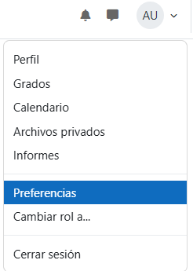
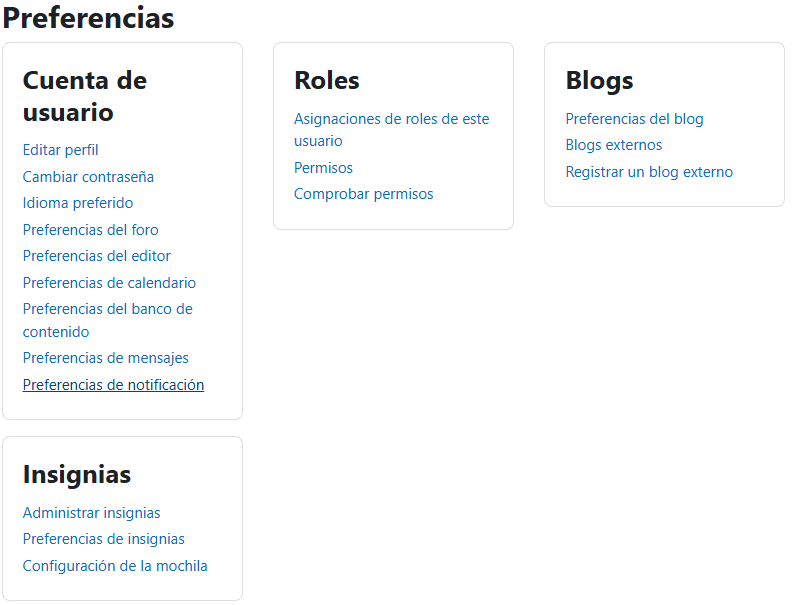

# Cómo silenciar las notificaciones

## Paso 1

haz clic en tu **icono de usuario** y luego un clic en **preferencias**.

## Paso 2

En cuenta de usuario haz un clic en **Preferencias de notificaciones**.

## Paso 3

Aqui puedes modificar las notificaciones que recibirás.

## Tipos de notificación

| Tipo | Descripción / Cuándo se envía | Canales por defecto |
| :--- | :--- | :--- |
| **Grade published notification** (`gradepublished`) | Se envía cuando se publica una calificación. | Ventana emergente (popup) y correo |
| **New follower notification** (`newfollower`) | Se envía cuando un nuevo usuario comienza a seguirte. | Ventana emergente (popup) y correo |
| **New comment notification** (`newcomment`) | Se envía cuando alguien comenta en tu publicación. | Ventana emergente (popup) y correo |
| **New report notification** (`newreport`) | Se envía a los usuarios que pueden moderar cuando alguien reporta contenido; no se envía a quien hizo el reporte. | Ventana emergente (popup) y correo |
